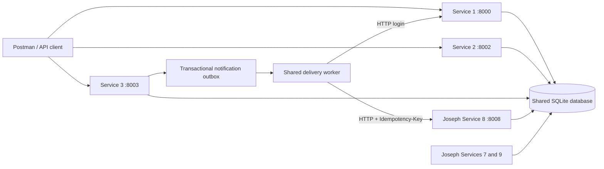
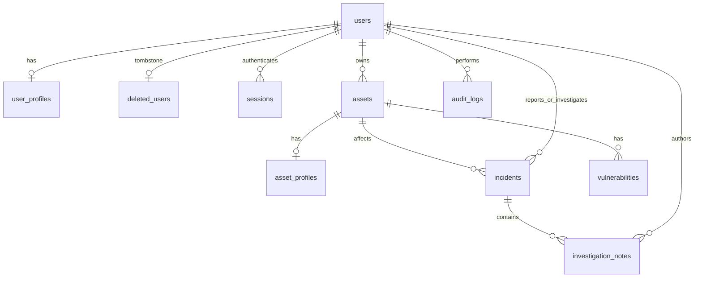

# Sprint I Services 1–3 (Hassan Nasrallah)

Hassan Nasrallah is responsible for Users and Identity Management, Asset Management, and Incident Management. Mohammad owns Services 4–6; Joseph Awaida owns Services 7–9. This contribution adds Hassan's three backend services to the existing FastAPI/SQLite project and leaves the final team merge to the team.

## Setup and demonstration (Hassan Nasrallah)

Use Python 3.11 or newer. From the repository root on Windows:

```powershell
python -m venv .venv
.venv/Scripts/python.exe -m pip install -r requirements-lock.txt
.venv/Scripts/python.exe -m scripts.seed_hassan
.venv/Scripts/python.exe -m scripts.run_hassan --with-joseph
```

On macOS/Linux use `.venv/bin/python` instead. Omit `--with-joseph` to run only Services 1–3. Do not run the original `scripts.run` simultaneously, because both runners use identity port 8000. The new runner selects Hassan's actual Service 1; Joseph's original runner continues to select his temporary identity adapter.

| Service | Port | OpenAPI and interactive reference |
| --- | --- | --- |
| 1 Users and Identity | 8000 | `/docs`, `docs/hassan/service-1.openapi.json` |
| 2 Assets | 8002 | `/docs`, `docs/hassan/service-2.openapi.json` |
| 3 Incidents | 8003 | `/docs`, `docs/hassan/service-3.openapi.json` |

Every business API and health route in these services begins with **`/Hassan-Nasrallah`**. FastAPI's infrastructure documentation routes remain `/docs`, `/redoc`, `/openapi.json`. The development seed writes randomly generated role passwords into ignored `data/demo-credentials.json`; it preserves existing users and passwords. An existing installation without that credentials file needs the original passwords or a separate disposable development database. Do not delete a team database to reset demonstration credentials.

`DATABASE_PATH` selects the SQLite database (default `data/security.sqlite3`). Both `app/schema.sql` and `app/sprint123_schema.sql` initialize idempotently. Existing records are retained. Reference users/assets created by Joseph remain readable, with null profile metadata until completed by the new APIs or the development metadata seed.

## Architecture and integration (Hassan Nasrallah)



Each service is an independently runnable FastAPI process. Request models use typed classes, inheritance and shared validators; authorization, database transactions and notification delivery reuse the existing project components. `app.common.create_app` now accepts an optional route prefix; its default stays Joseph's prefix. The only other shared initialization change loads the new schema after the existing schema.

The local deployment uses the existing shared SQLite database, foreign keys and opaque session verification. This is the team's current integration contract. It is not a separate-database microservice deployment. An HTTP identity verification endpoint is available at `GET /Hassan-Nasrallah/users/session` for teammates that need remote verification. It returns safe current user information and never a password or token hash.

Assigning an incident commits its analyst assignment, an explicit `Incident assigned` audit entry and a notification outbox event in the same transaction. The existing `NotificationDelivery` sends events over real HTTP to Joseph's notification API. Retries use the event ID as `Idempotency-Key`; repeating the same assignment does not enqueue a second alert. A temporary Service 8 outage does not lose the event or roll back the incident assignment. The worker retries pending events.

The new runner sets `IDENTITY_LOGIN_URL=http://127.0.0.1:8000/Hassan-Nasrallah/users/login`. Existing `NOTIFICATIONS_API_URL`, `SERVICE_USERNAME`, `SERVICE_PASSWORD` and `DATABASE_PATH` settings continue to work. Worker credentials default to the local seeded administrator account. Use an agreed service identity/permission model for a deployment beyond this local sprint.

Permission denials and successful authenticated mutations persist in Joseph's existing immutable `audit_logs` table. Mohammad's Service 5 endpoint has not been supplied, so remote audit forwarding remains a team integration item. Services 4–6 are not implemented by this contribution.

## Authentication and permissions (Hassan Nasrallah)

Passwords use the existing salted PBKDF2-HMAC-SHA256 implementation with 600,000 iterations. Registration requires 12–128 characters with uppercase, lowercase, digit and symbol. Password whitespace is preserved. Login accepts username or case-insensitive email in the `username` field. Tokens are opaque, randomly generated, expire after one hour and are stored only as SHA-256 hashes. Current account status and role are checked for every protected request. Status/role changes revoke all sessions for the affected user; logout revokes the current token. Suspended and inactive users cannot authenticate.

Public registration accepts only `employee`. An authenticated administrator can create any of the four roles. Employees can register and update/view themselves; analysts and auditors cannot register accounts through the management API. This prevents public role escalation despite the registration body containing a required `role` field.

| Operation | admin | analyst | employee | auditor |
| --- | --- | --- | --- | --- |
| List users / view role permissions | Yes | No | No | Yes |
| Retrieve user by username | Any | No | Own | Any |
| Update profile | Any | No | Own | No |
| Delete account / change role/status | Yes | No | No | No |
| Add/update/delete asset | Yes | No | No | No |
| List assets / view history | Yes | No | No | Yes |
| Search assets | Yes | Yes | No | Yes |
| Retrieve asset | Any | Related to assigned incidents | No | Any |
| Report incident | Yes | No | As self | No |
| List/retrieve incidents | All | Assigned | Submitted | All |
| Assign incident | Yes | No | No | No |
| Advance status / add note | Yes | Assigned | No | No |

The brief's general permissions require analysts to view assigned incidents and employees to view submitted incidents. The collection endpoint therefore supports these two scoped lists in addition to the administrator/auditor all-records view. Employees receive incident status/details but no private investigation notes. An analyst's direct asset lookup must relate to an incident assigned to them; the explicitly permitted asset search endpoint remains available.

The final active administrator cannot be demoted or suspended. Administrators cannot delete themselves. Open investigations must be reassigned before removing an analyst role or deleting that analyst.

## API reference (Hassan Nasrallah)

Prefix every endpoint below with `/Hassan-Nasrallah` and send `Authorization: Bearer <access_token>` except public registration/login. Complete field types, constraints, response schemas and descriptions are in the three checked-in OpenAPI files and each service's `/docs`.

| Service | Method | Endpoint | Request / purpose |
| --- | --- | --- | --- |
| 1 | POST | `/users/register` | full_name, username, email, password, department, role |
| 1 | POST | `/users/login` | username (or email), password; returns bearer token |
| 1 | PUT | `/users/{id}` | Nonempty subset of full_name, email, department |
| 1 | DELETE | `/users/{id}` | Delete account, revoke sessions, retain audit tombstone |
| 1 | GET | `/users` | Safe profiles, `limit` 1–500 and nonnegative `offset` |
| 1 | GET | `/users/{username}` | Retrieve safe profile by username |
| 1 | GET | `/users/session` | Current authenticated identity and role |
| 1 | POST | `/users/logout` | Revoke current bearer session |
| 1 | GET | `/users/{id}/roles` | Current role and Services 1–3 permissions |
| 1 | PUT | `/users/{id}/role` | role: admin, analyst, employee, auditor |
| 1 | DELETE | `/users/{id}/role` | Remove privileged role by resetting to employee |
| 1 | PUT | `/users/{id}/account-status` | account_status: Active, Inactive, Suspended |
| 2 | POST | `/assets` | name, asset_type, ip_address, department, owner_id, location, criticality; optional operating_system and status |
| 2 | PUT | `/assets/{id}` | Nonempty subset of asset creation fields |
| 2 | DELETE | `/assets/{id}` | Remove unreferenced asset; retain history |
| 2 | GET | `/assets` | Paginated asset records |
| 2 | GET | `/assets/{id}` | Asset plus incident_ids and vulnerability_ids |
| 2 | GET | `/assets/search` | name, asset_type, ip_address, department, criticality; filters combine with AND |
| 2 | GET | `/assets/{id}/history` | Immutable timestamped snapshots and actor identifiers |
| 3 | POST | `/incidents` | title, description, category, severity, reporter_id, asset_id |
| 3 | GET | `/incidents` | Paginated visible incident records |
| 3 | GET | `/incidents/{id}` | Incident and investigation_notes |
| 3 | PUT | `/incidents/{id}/assign` | analyst_id; active analyst only |
| 3 | PUT | `/incidents/{id}/status` | status; sequential lifecycle |
| 3 | POST | `/incidents/{id}/notes` | content; author/timestamp supplied by server |

### Registration and login

```json
{
  "full_name": "Demo Employee",
  "username": "demo.employee",
  "email": "employee@example.test",
  "password": "DevelopmentDemo123!",
  "department": "IT",
  "role": "employee"
}
```

Successful registration returns HTTP 201 with `id`, `full_name`, `username`, `email`, `department`, `role`, `account_status`, `created_at`, and `last_login_at`. No password/hash appears in responses. Usernames use 3–64 ASCII letters, digits, dots, underscores or hyphens; `session` is reserved for the identity verification endpoint. SQL uniqueness constraints enforce username uniqueness and case-insensitive email uniqueness, including concurrent requests; duplicates return 409 and the transaction rolls back. Login returns `access_token`, `token_type`, `expires_in`, `user_id`, and `role`; never include its token in public evidence.

### Asset creation

```json
{
  "name": "Application server",
  "asset_type": "Server",
  "ip_address": "192.0.2.10",
  "department": "IT",
  "owner_id": 3,
  "location": "Lab",
  "criticality": "High",
  "status": "Active"
}
```

Owner IDs must identify an active account. Valid types are Server, Workstation, Database, Application, Network Device, Cloud Resource. IPv4 and IPv6 are validated and canonicalized. Criticality is Low, Medium, High, Critical; status is Active, Inactive, Under Maintenance. HTTP 201 returns the stored fields plus `id`, nullable `operating_system` and `created_at`. Asset updates retain before/after snapshots. Name search uses literal case-insensitive substring matching; other filters are exact. Empty searches return `[]`.

### Incident investigation

```json
{
  "title": "Suspicious login",
  "description": "Unexpected access from an unfamiliar host",
  "category": "Unauthorized access",
  "severity": "High",
  "reporter_id": 3,
  "asset_id": 1
}
```

Use actual user/asset IDs from the running system. Creation returns HTTP 201 with the fields above plus `id`, `assigned_analyst_id` (initially null), `status` (Open), `created_at`, `resolution_date` (initially null). Severity is Low, Medium, High or Critical. The server rejects attempts to supply status or assignee at creation. Only administrators can assign an active analyst, using `{"analyst_id":2}`. Administrators and that assigned analyst can add `{"content":"Reviewed access logs"}` and advance status.

The lifecycle is **Open → Under Investigation → Mitigated → Resolved → Closed**. Each change advances exactly one step; repeating the current status is idempotent. Skips, backward changes and reopening return 409. The server generates `resolution_date` at Resolved and preserves it at Closed. Closed incidents cannot receive notes or be reassigned. Notes store incident ID, authenticated author ID, content and UTC creation time.

### Errors and validation

Errors use `{"status":"error","message":"..."}`. Field validation also includes an `errors` array with field/message entries. Common responses are 401 missing/invalid/expired/revoked token or inactive account; 403 forbidden role or ownership; 404 absent resource; 409 duplicate record, foreign-key conflict, protected administrator or invalid workflow; 422 invalid fields, enums, IP/email, weak password or inactive assignee/owner.

Bodies reject unknown keys, blank required text, empty updates and explicit null updates except clearing optional operating_system. Parameterized SQL keeps input separate from SQL syntax. Dynamic SQL identifiers come only from fixed schema/model field names. Integer identifiers reject booleans. Passwords, session hashes and tokens never appear in safe user models. Database foreign keys prevent deletion of an asset referenced by an incident or vulnerability.

## Database design (Hassan Nasrallah)



`users(id,full_name,username,password_hash,role,account_status)` and `assets(id,name,owner_id)` remain compatible with Joseph's original tables. `user_profiles` adds a one-to-one user key, unique case-insensitive email, department, creation time and last login time. `asset_profiles` adds a one-to-one asset key, type, IP, OS, department, location, criticality, status and creation time. Splitting metadata into extension tables avoids a destructive migration or a change to Joseph's existing inserts.

`incidents` has a primary key, required reporter/asset foreign keys, optional assigned analyst foreign key, validated severity/status and timestamps. `investigation_notes` has its own primary key and foreign keys to the incident and authenticated author. Indexed reporter, analyst and asset IDs support scoped lists and relationship queries. `asset_history` preserves JSON snapshots, actor ID, action and timestamp. Its IDs deliberately remain historical references rather than cascading foreign keys, so deleting an asset cannot erase its history; update/delete triggers make history immutable. Asset ID allocation accounts for historical IDs to prevent accidental reuse.

Account deletion removes personal profile metadata, revokes sessions and anonymizes/deactivates the base identity, retaining `deleted_users(user_id,deleted_at)` as a tombstone. Deleted accounts disappear from all user management reads and cannot be reactivated through the API. This preserves immutable audit records and foreign keys. Original usernames/emails may be registered again; opaque sessions cannot revive the old identity. This deletion behavior is explicit rather than silently dropping audit history.

## Verification and required evidence (Hassan Nasrallah)

```powershell
.venv/Scripts/python.exe -m pytest -q
.venv/Scripts/python.exe -m scripts.artifacts_hassan
.venv/Scripts/python.exe -m scripts.prepare_hassan_newman
```

With local servers running, execute the generated collection:

```powershell
npx --yes newman run postman/Hassan-Services-1-2-3.postman_collection.json -e data/hassan-newman-local.postman_environment.json
```

Alternatively import the public collection/environment in Postman, fill the four role passwords from the local credentials file and run folders in order. The generated environment under `data/` contains real passwords and must remain ignored. Each run creates uniquely named accounts/assets/incidents; required incident records are intentionally retained. Collection scripts record actual runtime IDs/tokens and assert expected statuses; requests include descriptions. `evidence/hassan/validation-summary.json` records measured test/Newman outcomes after execution. Generated OpenAPI is documentation, not execution evidence.

The tests cover password hashing, failed/successful authentication, registration escalation, duplicate usernames/emails, profile ownership, revoked/expired/suspended sessions, all four roles, asset search/validation/history, foreign keys, analyst assignment scope, reporter ownership, complete incident lifecycle and Service 8 retry/idempotency integration. Existing Services 7–9 tests run in the same suite.

For the final shared report, capture genuine Postman request/response screenshots for each required API, invalid inputs, a failed/successful login, role denials, and all four incident transitions. Also capture actual database schemas/records and GitHub contribution history. Caption each with **Hassan Nasrallah — operation — purpose**. Do not expose passwords, Authorization headers or login token responses. Automated test and HTTP results are not a substitute for the required Postman desktop screenshots. The repository's existing Joseph screenshots belong to Joseph's work and are not Hassan's evidence.

## Team merge handoff (Hassan Nasrallah)

Merge this branch after reviewing it with Mohammad and Joseph. Keep each student's route prefix and collection/report ownership. Shared changes are limited to optional prefix support in `create_app`, loading the extension schema in `initialize`, and the README; resolve any concurrent teammate edits to those small sections deliberately. New filenames contain `hassan` where they might otherwise collide with report/collection generation scripts. Do not overwrite Joseph's report, collection or evidence.

For Mohammad: use Service 1 bearer sessions or the `/users/session` HTTP contract for authentication; retain role values admin/analyst/employee/auditor and Active/Inactive/Suspended statuses. Service 5 can consume the existing local audit records after an authenticated API contract is agreed; remote forwarding is pending. Service 6 can read the documented incident/asset APIs with authorized credentials. For Joseph: use the new identity login URL in integrated mode. Shared user/asset IDs and token hashing remain compatible. Service 3's assignment producer now sends the documented Incident Assignment payload through the shared outbox/HTTP worker.

The common team report, Mohammad's services, full team evidence and final submission remain team work. The contribution documentation covers Hassan's implementation and can be incorporated under report headings attributed to him.

## Development references and AI disclosure (Hassan Nasrallah)

The supplied Sprint I brief defines the requirements. FastAPI and Pydantic behavior is documented through the repository's OpenAPI schemas and pinned dependencies; the implementation builds on the team's existing authentication, SQLite and HTTP-delivery modules. AI assistance was used to inspect requirements/code, implement Services 1–3, create tests, and prepare the Postman collection and this contribution documentation. Hassan should review and be able to explain and demonstrate the submitted implementation. No fabricated execution, screenshots, commit history or teammate work is included.
