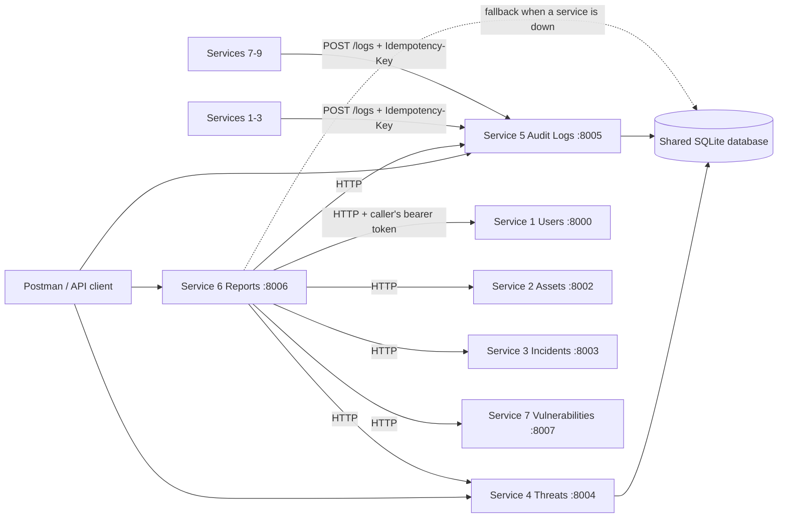
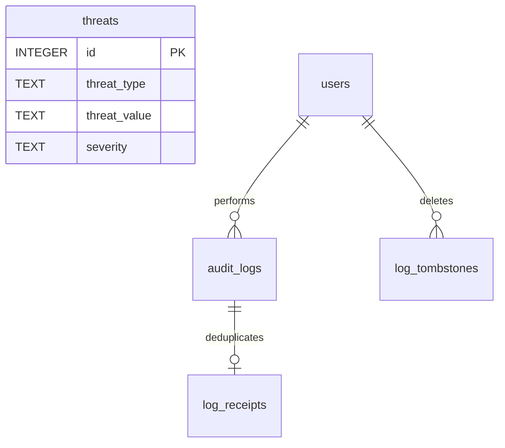

# Sprint I Services 4–6 (Mohammad Nasrallah)

Mohammad Nasrallah is responsible for Threat Intelligence, Security Audit Logging and Security Reports. Hassan Nasrallah owns Services 1–3; Joseph Awaida owns Services 7–9. This contribution adds Services 4–6 on top of Hassan's branch and leaves the final team merge to the team.

## Setup and demonstration (Mohammad Nasrallah)

Use Python 3.11 or newer. From the repository root on Windows:

```powershell
python -m venv .venv
.venv/Scripts/python.exe -m pip install -r requirements-lock.txt
.venv/Scripts/python.exe -m scripts.seed_hassan
.venv/Scripts/python.exe -m scripts.seed_mohammad
.venv/Scripts/python.exe -m scripts.run_mohammad --with-team
```

On macOS/Linux use `.venv/bin/python`. Omit `--with-team` to run only Services 4–6; include it to also run Hassan's Services 1–3 and Joseph's Services 7–9, which Service 6 collects from over HTTP. Do not run `scripts.run`, `scripts.run_hassan` and `scripts.run_mohammad --with-team` at the same time, because they share ports.

| Service | Port | Routes |
| --- | --- | --- |
| 4 Threat Intelligence | 8004 | `/Mohammad-Nasrallah/threats` |
| 5 Security Audit Logging | 8005 | `/Mohammad-Nasrallah/logs` |
| 6 Security Reports | 8006 | `/Mohammad-Nasrallah/reports` |

Every business API and health route begins with **`/Mohammad-Nasrallah`**. FastAPI's documentation routes remain `/docs`, `/redoc` and `/openapi.json`. Authentication uses Hassan's Service 1 on port 8000; `scripts.seed_hassan` writes the four role passwords into ignored `data/demo-credentials.json`.

`scripts.seed_mohammad` inserts nine threat indicators covering every supported type and all four severity levels so the threat report shows a meaningful distribution. It preserves existing indicators and is safe to re-run. It deliberately does **not** fabricate audit records: those are produced by real system activity.

## Architecture and integration (Mohammad Nasrallah)



Each service is an independently runnable FastAPI process reusing the project's existing components: `app.common.create_app` for the application shell and error handlers, `app.auth` for bearer authentication and role checks, and `app.db` for the shared SQLite connection. The only shared-file change is one line in `app/db.py:initialize` that loads `app/sprint456_schema.sql` after the existing schemas — the same kind of change Hassan made for his own schema.

Service 6 reads each source over HTTP first, following the documented `limit`/`offset` pagination, and falls back to a direct read of the shared database when a service is unreachable. Every report response carries a `sources` array naming each source and whether it resolved via `api` or `database`, so the collection path is visible in the response itself rather than only in documentation.

Service 6 **forwards the caller's own bearer token** to each source service instead of holding a service account. Only administrators and auditors can generate reports, and both roles already hold read permission on users, assets, incidents, threats, logs and vulnerabilities, so no credentials are stored anywhere and a report can never expose data the caller was not entitled to.

## Authentication and permissions (Mohammad Nasrallah)

All three services reuse Hassan's Service 1 sessions: opaque bearer tokens, stored only as SHA-256 hashes, expiring after one hour, with the account's current status and role checked on every protected request. Roles are `admin`, `analyst`, `employee` and `auditor`; account statuses are `Active`, `Inactive` and `Suspended`. Identity can also be verified over HTTP at `GET /Hassan-Nasrallah/users/session`.

| Operation | admin | analyst | employee | auditor |
| --- | --- | --- | --- | --- |
| Add / update / delete threat indicator | Yes | No | No | No |
| List / retrieve threat indicator | Yes | Yes | No | Yes |
| Search threat indicators | Yes | Yes | No | No |
| Create log record (including service ingestion) | Yes | No | No | No |
| List all logs / retrieve logs by user | Yes | No | No | Yes |
| Retrieve specific log / search logs | Yes | Yes | No | Yes |
| Delete log | Yes | No | No | No |
| Generate any security report | Yes | No | No | Yes |

**Two deliberate deviations from the brief's general role list, both resolved in favour of the per-service authorization tables**, which are the more specific requirement:

1. The general auditor list (§D) includes "Search threat indicators", but Service 4's own authorization table grants search only to administrators and analysts. Auditors therefore receive 403 on `GET /threats/search` while retaining full list and retrieve access.
2. The general auditor list includes "Search audit logs" and Service 5's table grants it, so auditors can search logs. Service 5's table grants analysts only the specific-log read and search, not the full listing or logs-by-user, so analysts receive 403 on those two.

Permission denials are recorded automatically by the existing `auth.deny`, which writes a `Permission denied` record at `Warning` severity before returning 403. Successful authenticated mutations are recorded by the existing middleware in `common.create_app`.

## Service 5 integration contract (for Hassan and Joseph)

See [`MOHAMMAD-SERVICE5-INTEGRATION.md`](MOHAMMAD-SERVICE5-INTEGRATION.md) for the endpoint, request format, authentication requirements and idempotency rules to use when forwarding audit events.

## API reference (Mohammad Nasrallah)

Prefix every endpoint with `/Mohammad-Nasrallah` and send `Authorization: Bearer <access_token>`.

| Service | Method | Endpoint | Request / purpose |
| --- | --- | --- | --- |
| 4 | POST | `/threats` | threat_type, threat_value, description, severity, source |
| 4 | GET | `/threats` | Paginated indicators, `limit` 1–500 and nonnegative `offset` |
| 4 | GET | `/threats/search` | threat_type, threat_value, severity, source; filters combine with AND |
| 4 | GET | `/threats/{id}` | Retrieve one indicator |
| 4 | PUT | `/threats/{id}` | Nonempty subset of description, severity, source |
| 4 | DELETE | `/threats/{id}` | Remove an indicator |
| 5 | POST | `/logs` | user_id, action, description, severity, related_service; optional `Idempotency-Key` header |
| 5 | GET | `/logs` | Paginated audit records, newest first |
| 5 | GET | `/logs/search` | user_id, action, severity, related_service, date_from, date_to |
| 5 | GET | `/logs/user/{user_id}` | All activity for one user |
| 5 | GET | `/logs/{id}` | Retrieve one audit record |
| 5 | DELETE | `/logs/{id}` | Remove an audit record; retains a deletion record |
| 6 | GET | `/reports/summary` | users, assets, open_incidents, critical_threats |
| 6 | GET | `/reports/incidents` | Totals and distribution by severity and status |
| 6 | GET | `/reports/assets` | Totals, critical assets and distribution by type |
| 6 | GET | `/reports/threats` | Totals, distribution by severity and type, recent indicators |
| 6 | GET | `/reports/vulnerabilities` | Totals, distribution by severity and status, critical count |
| 6 | GET | `/reports/activity` | Total activities, login attempts, failures, most performed actions |

### Adding a threat indicator

```json
{
  "threat_type": "IP Address",
  "threat_value": "198.51.100.24",
  "description": "Command-and-control host observed in outbound beaconing",
  "severity": "Critical",
  "source": "Internal detection"
}
```

HTTP 201 returns the stored fields plus `id` and `created_at`. Threat types are `IP Address`, `Domain`, `File Hash`, `Malware Signature` and `Other`; severity is `Low`, `Medium`, `High` or `Critical`.

Values are validated against their type and stored in canonical form, so equivalent indicators cannot both be stored:

- **IP Address** — parsed as IPv4 or IPv6 and canonicalized, so `2001:0DB8::F00D` is stored as `2001:db8::f00d`. Leading-zero octets such as `192.000.002.001` are **rejected**: they are ambiguous between decimal and octal and are a known filter-bypass technique.
- **Domain** — at least two labels, each 1–63 characters without leading or trailing hyphens, total length at most 253, lowercased with any trailing dot removed. A scheme, port, path or all-numeric final label is rejected.
- **File Hash** — hexadecimal of length 32, 40, 64 or 128 (MD5, SHA-1, SHA-256, SHA-512), lowercased.
- **Malware Signature** and **Other** — non-empty bounded text, whitespace trimmed.

A repeated threat type and value returns 409. Uniqueness is enforced by a database constraint rather than only in application code, so two concurrent inserts of the same indicator cannot both succeed. `PUT` accepts only description, severity and source: type and value are immutable, because editing them would move a record onto an existing pair and bypass the constraint.

### Audit records

Each record holds `id`, `user_id`, `action`, `description`, `severity`, `related_service` and `created_at`. Severity is `Information`, `Warning`, `Error` or `Critical`. `user_id` may be null for a system event with no identified user, which is how failed logins are recorded.

Service 5 reuses Joseph's existing `audit_logs` table and the automatic logging already present in the project rather than introducing a second logging mechanism. Records are generated automatically for successful and failed logins, registration, permission denials and every successful authenticated data modification across all nine services.

Audit records are append-only: no update endpoint exists on any service, and the existing `audit_no_update` database trigger aborts any `UPDATE` even from direct SQL. Only administrators may delete a record, and the deletion is itself retained — `log_tombstones` keeps the removed identifier, the administrator who removed it, the record's original action and timestamp, and the deletion time, under triggers that make those rows immutable too.

One implementation detail worth stating plainly: `audit_logs.id` is a plain `INTEGER PRIMARY KEY` in Joseph's existing `schema.sql`, so SQLite may reassign the highest deleted identifier to the next inserted record. Adding `AUTOINCREMENT` would mean recreating a table that already holds team records, so instead the deletion record proves which identifiers were deleted and when. After deleting the newest log, a request for that identifier may return a *different, newer* record rather than 404 — verify a deletion against the deletion record and the record's content, not by its identifier alone.

### Reports

```json
{
  "users": 4,
  "assets": 3,
  "open_incidents": 2,
  "critical_threats": 3,
  "sources": [
    {"name": "assets", "origin": "api", "detail": "http://127.0.0.1:8002/Hassan-Nasrallah/assets"},
    {"name": "incidents", "origin": "api", "detail": "http://127.0.0.1:8003/Hassan-Nasrallah/incidents"},
    {"name": "threats", "origin": "api", "detail": "http://127.0.0.1:8004/Mohammad-Nasrallah/threats"},
    {"name": "users", "origin": "api", "detail": "http://127.0.0.1:8000/Hassan-Nasrallah/users"}
  ]
}
```

Figures are computed from live data on every request; nothing is cached or pre-aggregated. An incident counts as open while its status is `Open`, `Under Investigation` or `Mitigated`. Source locations are configurable through `USERS_API_URL`, `ASSETS_API_URL`, `INCIDENTS_API_URL`, `THREATS_API_URL`, `LOGS_API_URL` and `VULNERABILITIES_API_URL`; `scripts.run_mohammad` sets them to the documented local ports.

### Errors and validation

Errors use the project's shared shape, `{"status":"error","message":"..."}`, with an additional `errors` array of field and message entries for field validation. Common responses: **401** missing, invalid, expired or revoked token, or an inactive account; **403** role not permitted, recorded as a permission denial; **404** absent record or unknown user; **409** duplicate threat indicator or an `Idempotency-Key` reused with a different payload; **422** invalid field, enum, threat value format, unknown referenced user, unknown body key, blank required text or an empty update.

Request bodies reject unknown keys and blank required text. All SQL is parameterized, so input never reaches SQL syntax; the only dynamically built SQL fragments are column names taken from fixed model field definitions, never from request data. `LIKE` search terms escape `%`, `_` and the escape character itself, so wildcards supplied by a user are matched literally.

## Database design (Mohammad Nasrallah)



`threats` is a new standalone table: primary key, constrained `threat_type` and `severity`, required description and source, a creation timestamp, and `UNIQUE(threat_type, threat_value)`. It has no foreign keys because a threat indicator is external intelligence that exists independently of any user or asset. An index on type, severity and source supports the search filters.

`audit_logs` is Joseph's existing table, reused unchanged. Service 5 adds an index on user, severity and related service to support its search and logs-by-user queries.

`log_receipts` maps an ingestion `Idempotency-Key` to the audit record created for it, with the payload hash used to detect a key reused for a different event. It references `audit_logs(id)`, and deleting a log clears its receipt first so the foreign key cannot block a permitted deletion.

`log_tombstones` records every administrator deletion of an audit record under its own `AUTOINCREMENT` key, so the sequence of deletions stays complete and ordered independently of the identifiers being deleted.

## Verification and required evidence (Mohammad Nasrallah)

```powershell
.venv/Scripts/python.exe -m pytest tests/test_mohammad_services.py -q
.venv/Scripts/python.exe -m scripts.postman_mohammad
```

The suite covers per-type threat value validation and canonicalization, rejection of leading-zero IPv4, duplicate indicators including canonical equivalents, immutable threat type and value, search filters combining with AND and literal wildcard handling, pagination bounds, all four roles against all three services, unauthenticated access, idempotent log ingestion including a replayed key and a key reused with a different payload, the single-row guarantee for an ingested event, append-only enforcement through both the API and direct SQL, audit retention records and their immutability, log search filters including date ranges, logs-by-user for a user with no activity and for an unknown user, report access control, and every report figure asserted equal to a direct database count over both the HTTP and fallback collection paths, with a reduced page size proving pagination is followed and a check that the caller's own credentials are what reach the source services.

**Screenshots must be captured from your own running system.** See [`MOHAMMAD-EVIDENCE-CHECKLIST.md`](MOHAMMAD-EVIDENCE-CHECKLIST.md) for the required list and caption format. Automated test output is not a substitute for the required Postman screenshots, and generated OpenAPI is documentation rather than execution evidence.

## Team merge handoff (Mohammad Nasrallah)

Merge this branch after reviewing it with Hassan and Joseph. It branches from `hassan/sprint-1-services-1-3`, so Hassan's branch should be merged first or merged together with it.

The single shared-file change is one line in `app/db.py:initialize` loading `app/sprint456_schema.sql`. If Hassan or Joseph edited `initialize` concurrently, keep all three `executescript` lines in schema order. Everything else is new files whose names contain `mohammad` where they could otherwise collide with teammate report, collection or evidence generation. Joseph's and Hassan's reports, collections and evidence are untouched.

For Hassan and Joseph: Service 5's ingestion endpoint is ready and documented in `MOHAMMAD-SERVICE5-INTEGRATION.md`, which removes the "remote audit forwarding is pending" integration item from Hassan's handoff. Service 6 consumes your documented list endpoints with `limit`/`offset` pagination and needs no change on your side; if you rename a route or change a field name, tell me so the collector's defaults stay correct.

## Development references and AI disclosure (Mohammad Nasrallah)

The supplied Sprint I brief defines the requirements. The implementation builds on the team's existing authentication, SQLite and application-shell modules, and on Hassan's Services 1–3 contract as documented in `HASSAN-SPRINT1.md`. FastAPI and Pydantic behaviour is pinned by `requirements-lock.txt`.

AI assistance (Claude) was used to inspect the brief and the existing codebase, implement Services 4–6, write the test suite, generate the Postman collection, and draft this contribution documentation. Mohammad Nasrallah should review the implementation and be able to explain and demonstrate it. Specific decisions taken during development and worth being able to defend:

- Reusing `audit_logs` and the project's existing automatic logging rather than adding a second logging mechanism.
- Suppressing the shared modification-audit middleware on `POST /logs` only, so ingesting one teammate event creates exactly one audit record instead of two, while deletions still produce a middleware record.
- Forwarding the caller's bearer token from Service 6 rather than storing a service account.
- Resolving the brief's two role-table contradictions in favour of the per-service authorization tables.
- Rejecting leading-zero IPv4 values, and canonicalizing values so the uniqueness constraint compares equivalent indicators.
- Recording audit deletions in `log_tombstones`, and the `audit_logs` identifier-reuse limitation described above.

No fabricated execution output, screenshots, commit history or teammate work is included in this contribution.
