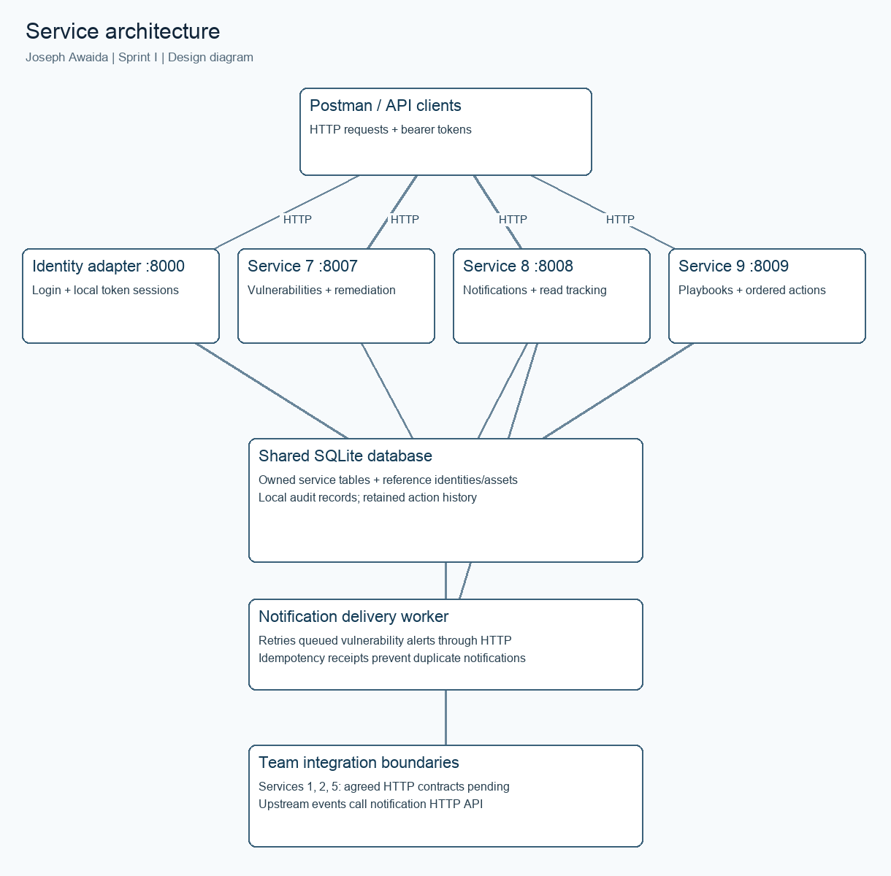
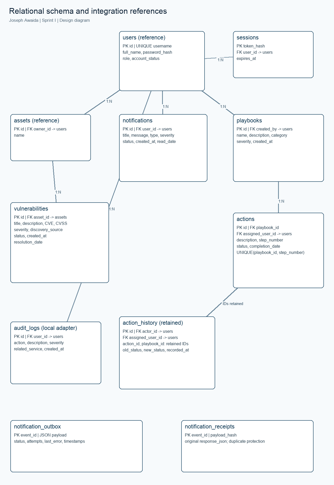

# Sprint I contribution report — Joseph Awaida

## 1. Title page (Joseph Awaida)
Security Incident Detection and Response Management System Backend. Software Tools Lab, Fall 2026–2027, Sprint I. Contribution: services 7, 8, and 9. Prepared 18 October 2026. GitHub: https://github.com/j123awaida/435L. This document is Joseph Awaida's contribution draft, to be merged into the team's common report with names, page numbers, real Postman screenshots, team history, and CREATES feedback.

## 2. Table of contents (Joseph Awaida)
The DOCX version contains a Word table-of-contents field. Update the field after merging the common report so page numbers reflect the final layout. Sections 1–11 here are Joseph Awaida's contribution. Other members must identify their own sections in the merged report.

## 3. Introduction (Joseph Awaida)
Organizations need consistent records of security weaknesses, notifications, and response procedures. These backend services associate discovered vulnerabilities with assets, deliver user alerts, and track ordered response actions. The implementation provides all eighteen required operations for this contribution, persistent relational storage, authentication, role checks, input validation, and runnable Postman scenarios. It does not implement the remaining six services or a frontend.

## 4. System architecture (Joseph Awaida)
Four independent FastAPI processes and a notification delivery worker run locally: a temporary identity adapter on port 8000, vulnerability management on 8007, notifications on 8008, and response playbooks on 8009. Postman and API clients communicate with each process over HTTP. A shared SQLite file supplies reference identities, assets, tokens, owned service tables, and local audit records. This Sprint I arrangement is appropriate for a local demonstration, but it does not provide independent service databases or the complete team's cross-service API integration.
The identity, asset, and audit interfaces are explicit team integration boundaries. Teammates must replace the temporary adapter and reference tables with agreed APIs for Services 1, 2, and 5. Upstream incident and threat services may create notifications by calling Service 8 with an authorized administrator session. Service 7 automatically queues a Vulnerability Alert for the affected asset owner. A worker delivers queued alerts to Service 8 over HTTP and retries failures; an idempotency receipt prevents duplicate delivery. Incident/threat event producers remain the responsibility of the corresponding teammates. See architecture.mmd for the diagram.

## 5. Implementation details (Joseph Awaida)
### Service 7: vulnerability management
The service creates, lists, retrieves, updates, searches, and deletes vulnerability records. Each record stores title, description, CVE identifier, CVSS, severity, asset, discovery source, lifecycle status, creation time, and resolution time. Creation checks that the asset exists and atomically queues an alert for its owner. A worker delivers it through the Service 8 HTTP API after commit. Search combines exact CVE, severity, asset, and status filters with AND. Empty results return an empty array.
For example, POST /Joseph-Awaida/vulnerabilities accepts {"title":"Exposed remote service","description":"Review required","cve_identifier":"CVE-2026-12345","cvss_score":9.1,"severity":"Critical","asset_id":1,"discovery_source":"Lab scanner"}. A successful creation returns HTTP 201 and the stored object, including its generated id and timestamps. This CVE is synthetic input for exercising the application, not a claim about a published vulnerability.
Severity is stored as a constrained text enum. The caller selects severity independently of CVSS; no automatic severity calculation is claimed. The workflow enforces Open → Under Investigation → In Progress → Resolved → Closed. Moving directly from Open to Closed returns 409. The server sets resolution_date on entering Resolved and preserves it on closure, rather than accepting arbitrary client timestamps. This deliberately protects chronology.
### Service 8: notification management
Notifications store recipient, title, message, type, severity, creation time, status, and read date. Administrators create alerts for existing users. Alert types cover incident assignments, security alerts, system events, threat alerts, and vulnerability alerts. Status starts Unread. Marking read sets a server timestamp only once, so repeated requests preserve the original read date.
For example, POST /Joseph-Awaida/notifications accepts {"user_id":3,"title":"Security alert","message":"Review suspicious activity","notification_type":"Security Alert","severity":"High"}. It returns HTTP 201 with the generated notification. GET /Joseph-Awaida/notifications/user/3 returns an array. A valid recipient with no notifications returns []. Analyst and employee access is limited to their own notifications; administrators and auditors can read across users. Only administrator, analyst, and employee roles may mark read, subject to ownership. Search accepts recipient, type, severity, and status. Analysts search only their own records; employees have no search permission.
### Service 9: playbooks and response actions
Playbooks store name, description, incident category, severity, creator, and creation date. Their response actions are returned in ascending step order, together with execution history. An action cannot be inserted before an already started step. Actions store description, positive unique step number within a playbook, status, assignee, and completion time. Administrators create/delete playbooks; administrators and analysts add actions and advance action status; auditors only read.
For example, POST /Joseph-Awaida/playbooks accepts {"name":"Malware containment","description":"Isolate and investigate","incident_category":"Malware","severity":"High"}. POST /Joseph-Awaida/playbooks/{id}/actions accepts {"description":"Isolate asset","step_number":1,"assigned_user_id":2}. PUT /Joseph-Awaida/actions/{id}/status accepts {"status":"In Progress"}. Successful updates return the persisted action. Steps progress Pending → In Progress → Completed. A user must be assigned before execution. Earlier steps must be completed before a later action starts. Completion time is generated by the server.
Each action creation/status update creates an immutable history row, including actor, assignee, old/new state, and time. Deleting a playbook cascades to its current actions but preserves execution history with the original action/playbook identifiers. Those history identifiers intentionally lack cascading foreign keys so deleted objects remain traceable.

## 6. Database design (Joseph Awaida)
The schema is app/schema.sql. SQLite foreign keys are enabled on every connection. Every operational table uses an integer primary key; session tokens use a SHA-256 digest primary key. Users own assets and receive notifications. Assets have many vulnerabilities. Users create playbooks. Playbooks contain many actions. Users can be assigned many actions and generate many history/audit entries. See schema.mmd for the ER diagram.

users is a minimal Service 1 reference with unique username, full name, password hash, role, and account status. assets is a minimal Service 2 reference with name and owner. They are integration scaffolding, not the full user/asset schemas required of the team. sessions holds hashed tokens, users, and expiry. vulnerabilities, notifications, playbooks, actions, and action_history belong to this contribution. audit_logs is a local Service 5 integration boundary and records permission denials and login results. All nine complete team service schemas must be merged by the team.
CHECK constraints validate database enum values, score ranges, and step numbers. UNIQUE(playbook_id, step_number) prevents ambiguous action ordering. Indexes support common vulnerability and notification filters. Parameterized queries prevent SQL injection; table names and update keys originate in trusted code/schema definitions. Transactions protect lifecycle updates from concurrent writes. History rows cannot be updated/deleted through database triggers. Audit rows cannot be updated. No audit modification API is exposed. Successful protected create/update/delete requests are automatically recorded by middleware. An outbox stores alert payloads and delivery status; receipt records store payload digests and original responses for idempotent HTTP delivery. No tokens or credentials are stored in outbox rows.

## 7. Error handling and validation (Joseph Awaida)
Requests reject unknown fields, empty or whitespace-only text, invalid CVE structure, scores outside 0–10, invalid severities/types/statuses, nonpositive identifiers, duplicate action steps, invalid references, and workflow skips. CVE identifiers must match CVE-YYYY-NNNN or longer numeric suffixes. This is syntactic validation, not a lookup in a CVE registry.
Errors consistently use {"status":"error","message":"..."}. Input errors also contain a sanitized list of field locations and messages. HTTP 401 identifies missing, invalid, expired authentication or inactive accounts; 403 identifies role or ownership denial; 404 indicates a nonexistent entity; 409 indicates constraint/workflow conflicts; 422 indicates malformed/invalid input. Internal SQL details are not returned in constraint errors. Permission violations persist in local audit logs with actor, method, path, related service, and warning severity.
Automated tests exercise all four roles, credentials, inactive accounts, ownership, malformed inputs, lifecycle ordering, action ordering, deletions, and history retention. Actual local execution records, database structure, and before/after data are saved by scripts/capture_evidence.py; evidence/SUMMARY.md records their outcome after execution. Genuine Postman desktop screenshots, database structure/record screenshots, and GitHub commit-history screenshots are embedded in the report appendices with captions identifying Joseph Awaida. The separate JSON records remain supplemental execution evidence.

## 8. API documentation (Joseph Awaida)
The full API list and request fields are in API.md; generated OpenAPI JSON documents include exact schemas. Interactive documentation is available at each process's /docs. All assignment endpoints include /Joseph-Awaida before the resource path. The Postman collection contains descriptions and assertions for all required operations plus success, failure, authorization, search, and workflow scenarios. Requests save tokens and created identifiers into local environment variables. The environment contains empty password/token fields so no credentials are published.
For reproduction, Postman users enter locally generated development passwords and run folders in order. The submitted screenshots were captured from an actual successful desktop run. Screenshots should show method, named route, request body as applicable, status, response body, and a caption such as “Joseph Awaida — Advance vulnerability to Under Investigation: demonstrates the permitted next lifecycle step.” Hide credentials and bearer tokens.

## 9. Authentication and authorization (Joseph Awaida)
The temporary identity adapter verifies salted PBKDF2-HMAC-SHA256 password hashes using 600,000 iterations and constant-time digest comparisons. Successful login returns a cryptographically random bearer token with a one-hour expiry. Only token digests are stored. Every service verifies token expiry, current account status, and role against the database on each request. Suspending a user immediately prevents use of an existing session.
admin corresponds to Security Administrator; analyst to Security Analyst; employee to Regular Employee/User; auditor to Auditor. Administrators have all eighteen operations. Analysts can read/update vulnerabilities, read their own notifications, mark their own notifications read, search their own notifications, read playbooks, and add/update response actions. Employees can only read/mark their own notifications. Auditors can read/search vulnerabilities and notifications and read playbooks; they cannot mutate records. Analysts cannot create/delete vulnerabilities, create/delete notifications, or create/delete playbooks. Forbidden role and ownership attempts are audited.
The development identity adapter is not a public registration service and does not allow callers to choose their own roles. The seed command provisions demo identities locally. Full identity registration/account management remains the responsibility of Service 1. Production deployment, distributed token verification, HTTPS termination, identity service contracts, and remote audit forwarding are outside this local Sprint I contribution.

## 10. GitHub and version control (Joseph Awaida)
Target repository: https://github.com/j123awaida/435L. The source and tests were successfully pushed to the repository on 18 October 2026. Commit history records implementation, tests, and documentation work. No backdated commits or teammate contributions are fabricated. Each teammate must push their own work, and the merged common report must include actual history/contribution screenshots. GitHub upload status must be checked against the actual push result; naming a target repository here is not proof of upload.

## 11. References and AI disclosure (Joseph Awaida)
Primary assignment: Final Project Fall 2026-2027-Sprint 1 (1).docx supplied by the student. Implementation documentation: https://fastapi.tiangolo.com/ ; https://docs.python.org/3/library/sqlite3.html ; https://docs.python.org/3/library/hashlib.html ; https://docs.pytest.org/ ; https://learning.postman.com/docs/collections/collections-overview/ .
OpenAI Codex assisted in interpreting requirements, implementing code, creating tests, preparing API/Postman artifacts, and drafting this report. Joseph Awaida must review and understand the implementation, reproduce its behavior, capture the required evidence, and accurately disclose assistance in the final team submission. The automated API evidence is produced by the local running implementation; none of it is claimed to be manually executed Postman evidence.

## 12. Reproduction and handoff (Joseph Awaida)
The README provides setup/run commands. scripts.notification_worker retries automatic vulnerability alerts; scripts.verify_integration checks real HTTP delivery and duplicate protection. scripts.validation_summary creates a public summary from actual JUnit/Newman artifacts. scripts.pdf_report creates a paginated PDF with a generated table of contents, diagrams, actual database structure, and before/after records. scripts.package_submission packages committed public files and excludes local credentials/runtime state.
See TEAM-INTEGRATION.md for the upstream notification contract and remaining teammate interfaces, and DEMONSTRATION.md for a practical walkthrough. After access was enabled, the actual Postman desktop client executed the collection successfully and its result/request views were captured through its Electron browser interface. SQLite-Web in read-only mode and headless Chrome supplied actual database and GitHub screenshots. Images are unedited; authentication token bodies and private password request bodies are excluded from public captures. The JSON records and generated design diagrams remain distinct from screenshot evidence.

## 13. Genuine screenshot evidence (Joseph Awaida)
The screenshot appendices contain real Postman runner requests/results for the 57 scenarios and actual database/GitHub browser captures. The desktop run passed all 84 assertions with zero errors. Every image has a caption naming Joseph Awaida and explaining the operation. Successful login captures show status and response headers instead of publishing bearer tokens. Password-containing resolved request bodies are omitted, while ordinary request bodies and responses are shown. The Postman collection retains the complete request definitions with password variables. Screenshot source URLs, capture times and captions are recorded in evidence/screenshots/postman-manifest.json and browser-manifest.json.
