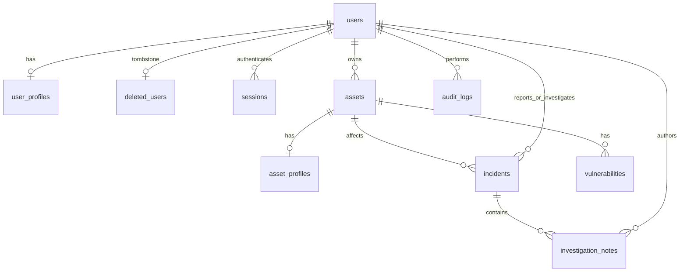
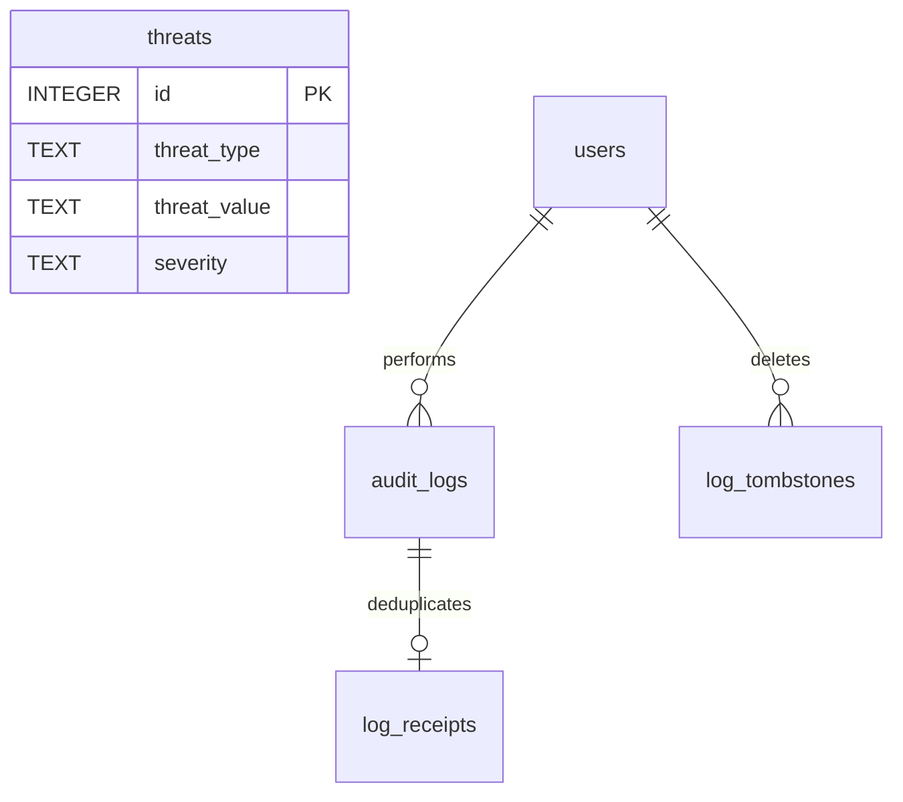

# Security Incident Detection and Response Management System — Sprint I

## Title page (Hassan Nasrallah, Mohammad Nasrallah, Joseph Awaida)
Software Tools Lab, Fall 2026–2027. Team: Hassan Nasrallah (Services 1–3), Mohammad Nasrallah (Services 4–6), Joseph Awaida (Services 7–9). Common team report assembled on 20 October 2026. Repository: https://github.com/j123awaida/435L. Submission folder: Hassan-Nasrallah-Mohammad-Nasrallah-Joseph-Awaida-430L.

## Introduction (Hassan Nasrallah, Mohammad Nasrallah, Joseph Awaida)
The backend records cybersecurity incidents, organizational assets, threat indicators, vulnerabilities, response workflows and audit activity. It provides nine independent REST services with authenticated access, four role types and persistent relational storage. A frontend is outside Sprint I scope. The goals are accountable incident investigation, repeatable response steps, timely user alerts and security reports derived from current records.

## System architecture (Hassan Nasrallah, Mohammad Nasrallah, Joseph Awaida)
Each service runs in its own FastAPI process. Hassan's Service 1 issues shared opaque bearer tokens; all protected services verify the session hash, expiry, current account status and role. The integrated launcher is scripts.run_team. The default service ports are 8000 and 8002–8009. The final validation used an isolated database on ports 18000 and 18002–18009 to preserve existing local records.
All services share SQLite. Hassan's schema adds user/asset profile tables and incident/note/history tables to Joseph's compatible reference identities/assets. Mohammad adds threat records and audit-ingestion/retention tables. The application initializes all three schema files in order. This is a local Sprint I architecture with separate API processes, rather than independently deployed database servers.
Incident assignments and vulnerability discovery transactionally queue notifications; a worker authenticates through Hassan's real login endpoint and delivers alerts to Joseph's Service 8 over HTTP. Durable retries and idempotency keys prevent duplicate notification delivery. Mohammad's Service 6 collects user, asset, incident, threat, audit and vulnerability records through the owning services' HTTP APIs. Source metadata reports whether HTTP or database fallback was used; final verification required every source to use HTTP and checked the returned figures against the database.
Audit records already written by the shared middleware and authorization checks are immediately visible to Service 5. They are not forwarded into the same shared table again, which would duplicate activity. The Service 5 HTTP ingestion endpoint is available for distinct events or a later separate-database deployment, and its actual retry behavior was verified.

## Team responsibility and Git merge (Hassan Nasrallah, Mohammad Nasrallah, Joseph Awaida)
Hassan Nasrallah implemented users/identity, assets and incidents. Mohammad Nasrallah implemented threats, audit logging and reports. Joseph Awaida implemented vulnerabilities, notifications and response playbooks/actions, and assembled the final integration/report/archive with Codex assistance. Original contributor names, route prefixes, code and history are preserved.
The published branches hassan/sprint-1-services-1-3 and mohammad/sprint-1-services-4-6 were fetched. Mohammad's branch contains Hassan's history. Both branches were fast-forward merged into main, retaining each original commit; no contributor history was fabricated or rewritten. The combined collection isolates runtime variables per contributor and uses Hassan's real identity endpoint for Joseph's login scenarios.

## Implementation — Services 1–3 (Hassan Nasrallah)
## Authentication and permissions (Hassan Nasrallah)

Passwords use the existing salted PBKDF2-HMAC-SHA256 implementation with 600,000 iterations. Registration requires 12–128 characters with uppercase, lowercase, digit and symbol. Password whitespace is preserved. Login accepts username or case-insensitive email in the `username` field. Tokens are opaque, randomly generated, expire after one hour and are stored only as SHA-256 hashes. Current account status and role are checked for every protected request. Status/role changes revoke all sessions for the affected user; logout revokes the current token. Suspended and inactive users cannot authenticate.

Public registration accepts only `employee`. An authenticated administrator can create any of the four roles. Employees can register and update/view themselves; analysts and auditors cannot register accounts through the management API. This prevents public role escalation despite the registration body containing a required `role` field.

| Operation | admin | analyst | employee | auditor |
| --- | --- | --- | --- | --- |
| List users / view role permissions | Yes | No | No | Yes |
| Retrieve user by username | Any | No | Own | Any |
| Update profile | Any | No | Own | No |
| Delete account / change role/status | Yes | No | No | No |
| Add/update/delete asset | Yes | No | No | No |
| List assets / view history | Yes | No | No | Yes |
| Search assets | Yes | Yes | No | Yes |
| Retrieve asset | Any | Related to assigned incidents | No | Any |
| Report incident | Yes | No | As self | No |
| List/retrieve incidents | All | Assigned | Submitted | All |
| Assign incident | Yes | No | No | No |
| Advance status / add note | Yes | Assigned | No | No |

The brief's general permissions require analysts to view assigned incidents and employees to view submitted incidents. The collection endpoint therefore supports these two scoped lists in addition to the administrator/auditor all-records view. Employees receive incident status/details but no private investigation notes. An analyst's direct asset lookup must relate to an incident assigned to them; the explicitly permitted asset search endpoint remains available.

The final active administrator cannot be demoted or suspended. Administrators cannot delete themselves. Open investigations must be reassigned before removing an analyst role or deleting that analyst.

## API reference (Hassan Nasrallah)

Prefix every endpoint below with `/Hassan-Nasrallah` and send `Authorization: Bearer <access_token>` except public registration/login. Complete field types, constraints, response schemas and descriptions are in the three checked-in OpenAPI files and each service's `/docs`.

| Service | Method | Endpoint | Request / purpose |
| --- | --- | --- | --- |
| 1 | POST | `/users/register` | full_name, username, email, password, department, role |
| 1 | POST | `/users/login` | username (or email), password; returns bearer token |
| 1 | PUT | `/users/{id}` | Nonempty subset of full_name, email, department |
| 1 | DELETE | `/users/{id}` | Delete account, revoke sessions, retain audit tombstone |
| 1 | GET | `/users` | Safe profiles, `limit` 1–500 and nonnegative `offset` |
| 1 | GET | `/users/{username}` | Retrieve safe profile by username |
| 1 | GET | `/users/session` | Current authenticated identity and role |
| 1 | POST | `/users/logout` | Revoke current bearer session |
| 1 | GET | `/users/{id}/roles` | Current role and Services 1–3 permissions |
| 1 | PUT | `/users/{id}/role` | role: admin, analyst, employee, auditor |
| 1 | DELETE | `/users/{id}/role` | Remove privileged role by resetting to employee |
| 1 | PUT | `/users/{id}/account-status` | account_status: Active, Inactive, Suspended |
| 2 | POST | `/assets` | name, asset_type, ip_address, department, owner_id, location, criticality; optional operating_system and status |
| 2 | PUT | `/assets/{id}` | Nonempty subset of asset creation fields |
| 2 | DELETE | `/assets/{id}` | Remove unreferenced asset; retain history |
| 2 | GET | `/assets` | Paginated asset records |
| 2 | GET | `/assets/{id}` | Asset plus incident_ids and vulnerability_ids |
| 2 | GET | `/assets/search` | name, asset_type, ip_address, department, criticality; filters combine with AND |
| 2 | GET | `/assets/{id}/history` | Immutable timestamped snapshots and actor identifiers |
| 3 | POST | `/incidents` | title, description, category, severity, reporter_id, asset_id |
| 3 | GET | `/incidents` | Paginated visible incident records |
| 3 | GET | `/incidents/{id}` | Incident and investigation_notes |
| 3 | PUT | `/incidents/{id}/assign` | analyst_id; active analyst only |
| 3 | PUT | `/incidents/{id}/status` | status; sequential lifecycle |
| 3 | POST | `/incidents/{id}/notes` | content; author/timestamp supplied by server |

### Registration and login

```json
{
  "full_name": "Demo Employee",
  "username": "demo.employee",
  "email": "employee@example.test",
  "password": "DevelopmentDemo123!",
  "department": "IT",
  "role": "employee"
}
```

Successful registration returns HTTP 201 with `id`, `full_name`, `username`, `email`, `department`, `role`, `account_status`, `created_at`, and `last_login_at`. No password/hash appears in responses. Usernames use 3–64 ASCII letters, digits, dots, underscores or hyphens; `session` is reserved for the identity verification endpoint. SQL uniqueness constraints enforce username uniqueness and case-insensitive email uniqueness, including concurrent requests; duplicates return 409 and the transaction rolls back. Login returns `access_token`, `token_type`, `expires_in`, `user_id`, and `role`; never include its token in public evidence.

### Asset creation

```json
{
  "name": "Application server",
  "asset_type": "Server",
  "ip_address": "192.0.2.10",
  "department": "IT",
  "owner_id": 3,
  "location": "Lab",
  "criticality": "High",
  "status": "Active"
}
```

Owner IDs must identify an active account. Valid types are Server, Workstation, Database, Application, Network Device, Cloud Resource. IPv4 and IPv6 are validated and canonicalized. Criticality is Low, Medium, High, Critical; status is Active, Inactive, Under Maintenance. HTTP 201 returns the stored fields plus `id`, nullable `operating_system` and `created_at`. Asset updates retain before/after snapshots. Name search uses literal case-insensitive substring matching; other filters are exact. Empty searches return `[]`.

### Incident investigation

```json
{
  "title": "Suspicious login",
  "description": "Unexpected access from an unfamiliar host",
  "category": "Unauthorized access",
  "severity": "High",
  "reporter_id": 3,
  "asset_id": 1
}
```

Use actual user/asset IDs from the running system. Creation returns HTTP 201 with the fields above plus `id`, `assigned_analyst_id` (initially null), `status` (Open), `created_at`, `resolution_date` (initially null). Severity is Low, Medium, High or Critical. The server rejects attempts to supply status or assignee at creation. Only administrators can assign an active analyst, using `{"analyst_id":2}`. Administrators and that assigned analyst can add `{"content":"Reviewed access logs"}` and advance status.

The lifecycle is **Open → Under Investigation → Mitigated → Resolved → Closed**. Each change advances exactly one step; repeating the current status is idempotent. Skips, backward changes and reopening return 409. The server generates `resolution_date` at Resolved and preserves it at Closed. Closed incidents cannot receive notes or be reassigned. Notes store incident ID, authenticated author ID, content and UTC creation time.

### Errors and validation

Errors use `{"status":"error","message":"..."}`. Field validation also includes an `errors` array with field/message entries. Common responses are 401 missing/invalid/expired/revoked token or inactive account; 403 forbidden role or ownership; 404 absent resource; 409 duplicate record, foreign-key conflict, protected administrator or invalid workflow; 422 invalid fields, enums, IP/email, weak password or inactive assignee/owner.

Bodies reject unknown keys, blank required text, empty updates and explicit null updates except clearing optional operating_system. Parameterized SQL keeps input separate from SQL syntax. Dynamic SQL identifiers come only from fixed schema/model field names. Integer identifiers reject booleans. Passwords, session hashes and tokens never appear in safe user models. Database foreign keys prevent deletion of an asset referenced by an incident or vulnerability.

## Database design (Hassan Nasrallah)



`users(id,full_name,username,password_hash,role,account_status)` and `assets(id,name,owner_id)` remain compatible with Joseph's original tables. `user_profiles` adds a one-to-one user key, unique case-insensitive email, department, creation time and last login time. `asset_profiles` adds a one-to-one asset key, type, IP, OS, department, location, criticality, status and creation time. Splitting metadata into extension tables avoids a destructive migration or a change to Joseph's existing inserts.

`incidents` has a primary key, required reporter/asset foreign keys, optional assigned analyst foreign key, validated severity/status and timestamps. `investigation_notes` has its own primary key and foreign keys to the incident and authenticated author. Indexed reporter, analyst and asset IDs support scoped lists and relationship queries. `asset_history` preserves JSON snapshots, actor ID, action and timestamp. Its IDs deliberately remain historical references rather than cascading foreign keys, so deleting an asset cannot erase its history; update/delete triggers make history immutable. Asset ID allocation accounts for historical IDs to prevent accidental reuse.

Account deletion removes personal profile metadata, revokes sessions and anonymizes/deactivates the base identity, retaining `deleted_users(user_id,deleted_at)` as a tombstone. Deleted accounts disappear from all user management reads and cannot be reactivated through the API. This preserves immutable audit records and foreign keys. Original usernames/emails may be registered again; opaque sessions cannot revive the old identity. This deletion behavior is explicit rather than silently dropping audit history.


## Implementation — Services 4–6 (Mohammad Nasrallah)
## Authentication and permissions (Mohammad Nasrallah)

All three services reuse Hassan's Service 1 sessions: opaque bearer tokens, stored only as SHA-256 hashes, expiring after one hour, with the account's current status and role checked on every protected request. Roles are `admin`, `analyst`, `employee` and `auditor`; account statuses are `Active`, `Inactive` and `Suspended`. Identity can also be verified over HTTP at `GET /Hassan-Nasrallah/users/session`.

| Operation | admin | analyst | employee | auditor |
| --- | --- | --- | --- | --- |
| Add / update / delete threat indicator | Yes | No | No | No |
| List / retrieve threat indicator | Yes | Yes | No | Yes |
| Search threat indicators | Yes | Yes | No | No |
| Create log record (including service ingestion) | Yes | No | No | No |
| List all logs / retrieve logs by user | Yes | No | No | Yes |
| Retrieve specific log / search logs | Yes | Yes | No | Yes |
| Delete log | Yes | No | No | No |
| Generate any security report | Yes | No | No | Yes |

**Two deliberate deviations from the brief's general role list, both resolved in favour of the per-service authorization tables**, which are the more specific requirement:

1. The general auditor list (§D) includes "Search threat indicators", but Service 4's own authorization table grants search only to administrators and analysts. Auditors therefore receive 403 on `GET /threats/search` while retaining full list and retrieve access.
2. The general auditor list includes "Search audit logs" and Service 5's table grants it, so auditors can search logs. Service 5's table grants analysts only the specific-log read and search, not the full listing or logs-by-user, so analysts receive 403 on those two.

Permission denials are recorded automatically by the existing `auth.deny`, which writes a `Permission denied` record at `Warning` severity before returning 403. Successful authenticated mutations are recorded by the existing middleware in `common.create_app`.

## Service 5 integration contract (for Hassan and Joseph)

See [`MOHAMMAD-SERVICE5-INTEGRATION.md`](MOHAMMAD-SERVICE5-INTEGRATION.md) for the endpoint, request format, authentication requirements and idempotency rules to use when forwarding audit events.

## API reference (Mohammad Nasrallah)

Prefix every endpoint with `/Mohammad-Nasrallah` and send `Authorization: Bearer <access_token>`.

| Service | Method | Endpoint | Request / purpose |
| --- | --- | --- | --- |
| 4 | POST | `/threats` | threat_type, threat_value, description, severity, source |
| 4 | GET | `/threats` | Paginated indicators, `limit` 1–500 and nonnegative `offset` |
| 4 | GET | `/threats/search` | threat_type, threat_value, severity, source; filters combine with AND |
| 4 | GET | `/threats/{id}` | Retrieve one indicator |
| 4 | PUT | `/threats/{id}` | Nonempty subset of description, severity, source |
| 4 | DELETE | `/threats/{id}` | Remove an indicator |
| 5 | POST | `/logs` | user_id, action, description, severity, related_service; optional `Idempotency-Key` header |
| 5 | GET | `/logs` | Paginated audit records, newest first |
| 5 | GET | `/logs/search` | user_id, action, severity, related_service, date_from, date_to |
| 5 | GET | `/logs/user/{user_id}` | All activity for one user |
| 5 | GET | `/logs/{id}` | Retrieve one audit record |
| 5 | DELETE | `/logs/{id}` | Remove an audit record; retains a deletion record |
| 6 | GET | `/reports/summary` | users, assets, open_incidents, critical_threats |
| 6 | GET | `/reports/incidents` | Totals and distribution by severity and status |
| 6 | GET | `/reports/assets` | Totals, critical assets and distribution by type |
| 6 | GET | `/reports/threats` | Totals, distribution by severity and type, recent indicators |
| 6 | GET | `/reports/vulnerabilities` | Totals, distribution by severity and status, critical count |
| 6 | GET | `/reports/activity` | Total activities, login attempts, failures, most performed actions |

### Adding a threat indicator

```json
{
  "threat_type": "IP Address",
  "threat_value": "198.51.100.24",
  "description": "Command-and-control host observed in outbound beaconing",
  "severity": "Critical",
  "source": "Internal detection"
}
```

HTTP 201 returns the stored fields plus `id` and `created_at`. Threat types are `IP Address`, `Domain`, `File Hash`, `Malware Signature` and `Other`; severity is `Low`, `Medium`, `High` or `Critical`.

Values are validated against their type and stored in canonical form, so equivalent indicators cannot both be stored:

- **IP Address** — parsed as IPv4 or IPv6 and canonicalized, so `2001:0DB8::F00D` is stored as `2001:db8::f00d`. Leading-zero octets such as `192.000.002.001` are **rejected**: they are ambiguous between decimal and octal and are a known filter-bypass technique.
- **Domain** — at least two labels, each 1–63 characters without leading or trailing hyphens, total length at most 253, lowercased with any trailing dot removed. A scheme, port, path or all-numeric final label is rejected.
- **File Hash** — hexadecimal of length 32, 40, 64 or 128 (MD5, SHA-1, SHA-256, SHA-512), lowercased.
- **Malware Signature** and **Other** — non-empty bounded text, whitespace trimmed.

A repeated threat type and value returns 409. Uniqueness is enforced by a database constraint rather than only in application code, so two concurrent inserts of the same indicator cannot both succeed. `PUT` accepts only description, severity and source: type and value are immutable, because editing them would move a record onto an existing pair and bypass the constraint.

### Audit records

Each record holds `id`, `user_id`, `action`, `description`, `severity`, `related_service` and `created_at`. Severity is `Information`, `Warning`, `Error` or `Critical`. `user_id` may be null for a system event with no identified user, which is how failed logins are recorded.

Service 5 reuses Joseph's existing `audit_logs` table and the automatic logging already present in the project rather than introducing a second logging mechanism. Records are generated automatically for successful and failed logins, registration, permission denials and every successful authenticated data modification across all nine services.

Audit records are append-only: no update endpoint exists on any service, and the existing `audit_no_update` database trigger aborts any `UPDATE` even from direct SQL. Only administrators may delete a record, and the deletion is itself retained — `log_tombstones` keeps the removed identifier, the administrator who removed it, the record's original action and timestamp, and the deletion time, under triggers that make those rows immutable too.

One implementation detail worth stating plainly: `audit_logs.id` is a plain `INTEGER PRIMARY KEY` in Joseph's existing `schema.sql`, so SQLite may reassign the highest deleted identifier to the next inserted record. Adding `AUTOINCREMENT` would mean recreating a table that already holds team records, so instead the deletion record proves which identifiers were deleted and when. After deleting the newest log, a request for that identifier may return a *different, newer* record rather than 404 — verify a deletion against the deletion record and the record's content, not by its identifier alone.

### Reports

```json
{
  "users": 4,
  "assets": 3,
  "open_incidents": 2,
  "critical_threats": 3,
  "sources": [
    {"name": "assets", "origin": "api", "detail": "http://127.0.0.1:8002/Hassan-Nasrallah/assets"},
    {"name": "incidents", "origin": "api", "detail": "http://127.0.0.1:8003/Hassan-Nasrallah/incidents"},
    {"name": "threats", "origin": "api", "detail": "http://127.0.0.1:8004/Mohammad-Nasrallah/threats"},
    {"name": "users", "origin": "api", "detail": "http://127.0.0.1:8000/Hassan-Nasrallah/users"}
  ]
}
```

Figures are computed from live data on every request; nothing is cached or pre-aggregated. An incident counts as open while its status is `Open`, `Under Investigation` or `Mitigated`. Source locations are configurable through `USERS_API_URL`, `ASSETS_API_URL`, `INCIDENTS_API_URL`, `THREATS_API_URL`, `LOGS_API_URL` and `VULNERABILITIES_API_URL`; `scripts.run_mohammad` sets them to the documented local ports.

### Errors and validation

Errors use the project's shared shape, `{"status":"error","message":"..."}`, with an additional `errors` array of field and message entries for field validation. Common responses: **401** missing, invalid, expired or revoked token, or an inactive account; **403** role not permitted, recorded as a permission denial; **404** absent record or unknown user; **409** duplicate threat indicator or an `Idempotency-Key` reused with a different payload; **422** invalid field, enum, threat value format, unknown referenced user, unknown body key, blank required text or an empty update.

Request bodies reject unknown keys and blank required text. All SQL is parameterized, so input never reaches SQL syntax; the only dynamically built SQL fragments are column names taken from fixed model field definitions, never from request data. `LIKE` search terms escape `%`, `_` and the escape character itself, so wildcards supplied by a user are matched literally.

## Database design (Mohammad Nasrallah)



`threats` is a new standalone table: primary key, constrained `threat_type` and `severity`, required description and source, a creation timestamp, and `UNIQUE(threat_type, threat_value)`. It has no foreign keys because a threat indicator is external intelligence that exists independently of any user or asset. An index on type, severity and source supports the search filters.

`audit_logs` is Joseph's existing table, reused unchanged. Service 5 adds an index on user, severity and related service to support its search and logs-by-user queries.

`log_receipts` maps an ingestion `Idempotency-Key` to the audit record created for it, with the payload hash used to detect a key reused for a different event. It references `audit_logs(id)`, and deleting a log clears its receipt first so the foreign key cannot block a permitted deletion.

`log_tombstones` records every administrator deletion of an audit record under its own `AUTOINCREMENT` key, so the sequence of deletions stays complete and ordered independently of the identifiers being deleted.


## Implementation — Services 7–9 (Joseph Awaida)
## 5. Implementation details (Joseph Awaida)
### Service 7: vulnerability management
The service creates, lists, retrieves, updates, searches, and deletes vulnerability records. Each record stores title, description, CVE identifier, CVSS, severity, asset, discovery source, lifecycle status, creation time, and resolution time. Creation checks that the asset exists and atomically queues an alert for its owner. A worker delivers it through the Service 8 HTTP API after commit. Search combines exact CVE, severity, asset, and status filters with AND. Empty results return an empty array.
For example, POST /Joseph-Awaida/vulnerabilities accepts {"title":"Exposed remote service","description":"Review required","cve_identifier":"CVE-2026-12345","cvss_score":9.1,"severity":"Critical","asset_id":1,"discovery_source":"Lab scanner"}. A successful creation returns HTTP 201 and the stored object, including its generated id and timestamps. This CVE is synthetic input for exercising the application, not a claim about a published vulnerability.
Severity is stored as a constrained text enum. The caller selects severity independently of CVSS; no automatic severity calculation is claimed. The workflow enforces Open → Under Investigation → In Progress → Resolved → Closed. Moving directly from Open to Closed returns 409. The server sets resolution_date on entering Resolved and preserves it on closure, rather than accepting arbitrary client timestamps. This deliberately protects chronology.
### Service 8: notification management
Notifications store recipient, title, message, type, severity, creation time, status, and read date. Administrators create alerts for existing users. Alert types cover incident assignments, security alerts, system events, threat alerts, and vulnerability alerts. Status starts Unread. Marking read sets a server timestamp only once, so repeated requests preserve the original read date.
For example, POST /Joseph-Awaida/notifications accepts {"user_id":3,"title":"Security alert","message":"Review suspicious activity","notification_type":"Security Alert","severity":"High"}. It returns HTTP 201 with the generated notification. GET /Joseph-Awaida/notifications/user/3 returns an array. A valid recipient with no notifications returns []. Analyst and employee access is limited to their own notifications; administrators and auditors can read across users. Only administrator, analyst, and employee roles may mark read, subject to ownership. Search accepts recipient, type, severity, and status. Analysts search only their own records; employees have no search permission.
### Service 9: playbooks and response actions
Playbooks store name, description, incident category, severity, creator, and creation date. Their response actions are returned in ascending step order, together with execution history. An action cannot be inserted before an already started step. Actions store description, positive unique step number within a playbook, status, assignee, and completion time. Administrators create/delete playbooks; administrators and analysts add actions and advance action status; auditors only read.
For example, POST /Joseph-Awaida/playbooks accepts {"name":"Malware containment","description":"Isolate and investigate","incident_category":"Malware","severity":"High"}. POST /Joseph-Awaida/playbooks/{id}/actions accepts {"description":"Isolate asset","step_number":1,"assigned_user_id":2}. PUT /Joseph-Awaida/actions/{id}/status accepts {"status":"In Progress"}. Successful updates return the persisted action. Steps progress Pending → In Progress → Completed. A user must be assigned before execution. Earlier steps must be completed before a later action starts. Completion time is generated by the server.
Each action creation/status update creates an immutable history row, including actor, assignee, old/new state, and time. Deleting a playbook cascades to its current actions but preserves execution history with the original action/playbook identifiers. Those history identifiers intentionally lack cascading foreign keys so deleted objects remain traceable.


## Shared database design (Hassan Nasrallah, Mohammad Nasrallah, Joseph Awaida)
The complete SQL schema is database/schema.sql, composed in initialization order from app/schema.sql, app/sprint123_schema.sql and app/sprint456_schema.sql. The database appendix lists observed tables, column types, primary keys and foreign keys. The model includes users, assets, incidents, investigation notes, threats, audit logs, vulnerabilities, notifications, playbooks and response actions, plus compatible profile extensions, sessions, outbox/receipt tables and retained histories.
User profiles and asset profiles extend original records without deleting teammate data. Deleted-user tombstones retain identity references for audit evidence; deleted accounts cannot authenticate. Incident notes reference their incident and authenticated author. Vulnerabilities reference affected assets. Playbook actions reference their playbook and qualified assignee; ordered step numbers are unique within a playbook. Action/asset history deliberately retains original identifiers after source deletion. Database CHECK, UNIQUE and foreign-key constraints complement request validation.
Schema, seed commands, actual sanitized records, schema metadata and the runnable combined collection are included. Demo passwords are generated locally and excluded from the submission. The package supplies scripts instead of publishing a live credential-bearing database or session tokens.

## Error handling, validation and security (Hassan Nasrallah, Mohammad Nasrallah, Joseph Awaida)
All services use a consistent error envelope with status=error and a meaningful message; field errors include field locations and messages. Responses distinguish 401 authentication, 403 authorization/ownership, 404 absent resource, 409 uniqueness/workflow conflicts, and 422 invalid request fields. Parameterized SQL separates values from query syntax; update/search identifiers come from trusted model definitions.
Validation covers required and blank fields, email/IP/domain/hash/CVE formats, password requirements, enum values, CVSS limits, referenced identities/assets, unique indicators, ordered actions and sequential incident/vulnerability transitions. Unknown body keys are rejected. Employees cannot promote their own role; auditors cannot mutate; analysts are limited by role and assignment/ownership. Denied operations and successful mutations are audited.
Passwords use salted PBKDF2-HMAC-SHA256 with 600,000 iterations. Only token hashes are stored; sessions expire after one hour. Role/status changes revoke affected sessions, and current account status is checked on every protected request. Inactive and suspended accounts cannot log in. No raw credentials or bearer-token responses appear in public evidence.

## API documentation (Hassan Nasrallah, Mohammad Nasrallah, Joseph Awaida)
The API appendix lists the actual methods, routes, owners and purposes from the running application schemas. Detailed parameter, request-body, response and validation schemas are in docs/team/service-1.openapi.json through service-9.openapi.json. Each process exposes /docs. All business routes retain the implementing student's full name in their prefix.
The original three Postman collections/environments are preserved. The additional Team-All-Services collection executes all member groups in sequence against the integrated launcher, avoiding collisions between similarly named variables. A public Team-Local environment has blank password fields; prepare_team_newman writes the private populated environment only under ignored data/.

## Actual validation and evidence (Hassan Nasrallah, Mohammad Nasrallah, Joseph Awaida)
The merged test suite passed 82 tests with zero failures and errors. The actual integrated Newman run executed 184 requests with 239 assertions and zero failures. Results are in evidence/team/pytest-results.xml, newman-output.txt, validation-summary.json and sanitized http-execution.json.
The integration verifier checked all six reports against actual database counts, required HTTP sources, verified Service 5 idempotent ingestion using real HTTP 201/200 responses, and ran the SQLite foreign-key check. This is actual execution evidence; documentation and diagrams are not presented as proof of API execution.
Genuine Postman desktop request/result screenshots and database/GitHub screenshots are included with captions identifying the service owner and purpose. Capture metadata identifies the shared team validation environment. Original Joseph evidence from 18 October is preserved as historical contribution evidence; the integrated team validation is separately dated. Token-bearing login responses use safe headers/status views, and password bodies are omitted when a secret would otherwise be visible.

## GitHub and contributions (Hassan Nasrallah, Mohammad Nasrallah, Joseph Awaida)
Repository: https://github.com/j123awaida/435L. The archive includes genuine commit history and original member branches are retained remotely. Contribution evidence reflects actual commits and API implementation ownership, not manufactured activity. The merge preserves the published Hassan and Mohammad commits as ancestors of main.

## References and AI disclosure (Hassan Nasrallah, Mohammad Nasrallah, Joseph Awaida)
Primary requirements: Final Project Fall 2026-2027-Sprint 1 (1).docx supplied for this course. Framework/reference documentation: https://fastapi.tiangolo.com/ ; https://docs.python.org/3/library/sqlite3.html ; https://docs.python.org/3/library/hashlib.html ; https://docs.pytest.org/ ; https://learning.postman.com/docs/collections/collections-overview/ .
The members' original disclosures are preserved in their contribution documents. Hassan's contribution used AI assistance for requirements/code review, implementation, tests and Postman/documentation preparation. Mohammad disclosed Claude assistance for implementation, tests, collection and documentation. Joseph used OpenAI Codex for Services 7–9, tests, execution/evidence capture and reports. Codex also assisted Joseph in the final branch merge, combined runner/collection, actual integration validation, common report and submission packaging. Every member should review and be able to explain their implementation and the disclosed assistance.

## Submission status (Hassan Nasrallah, Mohammad Nasrallah, Joseph Awaida)
The archive includes all nine services, database SQL/seed scripts, original and combined collections, common Word/PDF report, documentation, genuine evidence and GitHub link. Each member uploads the same common team package, as the assignment requires.
Personal and course-portal requirements remain outside software packaging: the team must confirm actual CREATES attendance and application of feedback at least three days before the true deadline; every member must review the common report and submit it through their own Moodle account. No attendance, coaching feedback, deadline or Moodle upload is invented or claimed here.
